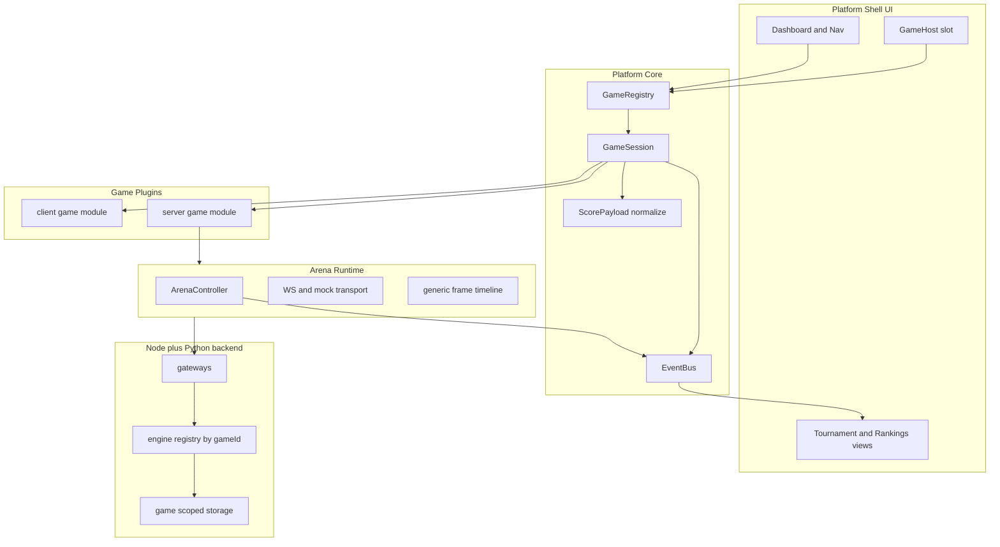

# Game Platform Refactoring Plan

Refactor the single-game web app **Đấu Trường Kéo Búa Bao** into a generic
**Game Platform** that can host many games without modifying the core.

Decision recorded: the platform must support **both** game kinds under one
contract:

- **client** games — self-contained React/Canvas plugins with lifecycle hooks
  (`init`, `start`, `pause`, `resume`, `destroy`, `getScore`, `onGameOver`).
- **server** games — the current server-authoritative bot arena, where a Python
  engine is the referee and the browser renders replay frames.

---

## 1. Current Architecture Analysis

### 1.1 Runtime model

The existing title is **not** a plain client game. It is a _server-authoritative
bot arena_:

1. Two teams submit Python bot files via HTTP (`POST /api/rooms/:code/submissions`).
2. A Node server ([`net/`](net/index.js:1)) holds rooms over WebSocket and, when
   both teams are ready, spawns the Python engine
   ([`net/engineRunner.js`](net/engineRunner.js:12), [`engine/match_runner.py`](engine/match_runner.py)).
3. The engine streams `match_start`, `turn`, `match_end` messages.
4. The React frontend only **observes and controls**: it turns replay frames
   into a board rendering ([`src/utils/replayEngine.js`](src/utils/replayEngine.js:99)).

### 1.2 Frontend layout today

- [`src/App.jsx`](src/App.jsx:10) — one component owns tab state, routing and the
  RPS branding; it is the de-facto "shell".
- [`src/hooks/useRoom.js`](src/hooks/useRoom.js:20) — merges transport WebSocket
  handling, room state, live-match state and frame building.
- [`src/pages/`](src/pages) — `Lobby`, `Room`, `Match`, `ReplayPage`,
  `DatabasePage`, all hard-wired to the RPS game.
- [`src/components/`](src/components) — board/piece renderers with RPS semantics.
- [`src/api.js`](src/api.js:1) + [`src/api/index.js`](src/api/index.js:1) — two
  different "api" entry points; the file imports from the directory.

### 1.3 Backend layout today

- [`net/index.js`](net/index.js:1) wires gateways + orchestrator.
- [`net/roomGateway.js`](net/roomGateway.js:37) owns room lifecycle and calls
  `runEngineMatch` directly (single engine).
- [`net/engineRunner.js`](net/engineRunner.js:9) hard-codes `engine/config.json`.
- [`net/storage/schema.sql`](net/storage/schema.sql:7) stores matches with no
  game dimension.

---

## 2. Code Smells & Extension Bottlenecks

| #   | Smell                                          | Location                                                                                 | Why it blocks scaling                               |
| --- | ---------------------------------------------- | ---------------------------------------------------------------------------------------- | --------------------------------------------------- |
| 1   | God component: state, routing, branding in one | [`App.jsx`](src/App.jsx:10)                                                              | Adding a game edits the core shell                  |
| 2   | Single-game branding hard-coded                | [`index.html`](index.html:6), [`App.jsx`](src/App.jsx:40)                                | No platform identity, not multi-game                |
| 3   | Game rules leak into shared engine             | [`replayEngine.js`](src/utils/replayEngine.js:31)                                        | `applyEvent` knows RPS events only -> OCP violation |
| 4   | Transport + state + replay mixed in one hook   | [`useRoom.js`](src/hooks/useRoom.js:20)                                                  | No seam for a leaderboard/tournament to subscribe   |
| 5   | No game identity in protocol/data              | [`docs/PROTOCOL.md`](docs/PROTOCOL.md:53), [`schema.sql`](net/storage/schema.sql:7)      | Rankings/history mix all games together             |
| 6   | Backend engine hard-coded                      | [`engineRunner.js`](net/engineRunner.js:9)                                               | Cannot select an engine per game                    |
| 7   | Two colliding API entry points                 | [`src/api.js`](src/api.js:1), [`src/api/index.js`](src/api/index.js:1)                   | Confusing layering, name collision file vs dir      |
| 8   | Empty platform scaffolding                     | [`src/platform/core/`](src/platform/core), [`src/games/_template/`](src/games/_template) | Half-finished intent -> structural drift risk       |
| 9   | Pages coupled to one game                      | [`Match.jsx`](src/pages/Match.jsx:11), [`ReplayPage.jsx`](src/pages/ReplayPage.jsx:32)   | New game must clone pages                           |
| 10  | Score payload is ad-hoc                        | [`replayEngine.js`](src/utils/replayEngine.js:76)                                        | Tournament API has no stable score contract         |
| 11  | No platform player identity                    | room team-name strings                                                                   | No PlayerID to rank/aggregate across games          |
| 12  | No real routing                                | [`App.jsx`](src/App.jsx:11) conditional render                                           | No deep links like /games/:id/matches/:mid          |

---

## 3. Target Architecture

### 3.1 Layering principles

- **Platform core** knows nothing about any concrete game.
- **Shell UI** renders navigation/state/tournament chrome and mounts a game slot.
- **Game plugins** own their canvas/viewport, rules, and replay interpretation.
- **Arena runtime** is shared infrastructure for `server` games (transport, room,
  replay timeline) and is injected into game viewers.
- **Event bus** is the single integration seam between games and platform
  features (scoreboard, tournament, analytics).



### 3.2 GameModule contract (unified)

Metadata + loader (registered in the registry):

```js
/**
 * @typedef {Object} GameManifest
 * @property {string} id                 // slug e.g. rps-arena
 * @property {string} name               // display name
 * @property {string} [description]
 * @property {string} [icon]
 * @property {"client"|"server"} kind
 * @property {Object} [capabilities]     // {leaderboard,tournament,multiplayer,solo}
 * @property {() => Promise<GamePlugin>} load   // dynamic import
 */
```

Runtime plugin returned by `load()` — identical lifecycle for both kinds:

```js
/**
 * @typedef {Object} GamePlugin
 * @property {GameManifest} manifest
 * @property {(ctx: GameContext) => Promise<void>} init
 * @property {() => Promise<void>} start
 * @property {() => void} pause
 * @property {() => void} resume
 * @property {() => void} destroy
 * @property {() => ScorePayload} getScore
 * @property {(cb:(e:GameOverEvent)=>void) => void} onGameOver
 * // client-kind rendering
 * @property {React.ComponentType} [Component]
 * // server-kind rendering + interpretation
 * @property {React.ComponentType} [Viewer]
 * @property {Object} [replay]   // {buildFrames, applyEvent, describeEvent}
 * @property {string} [engineId] // maps to backend engine registry
 */
```

`GameContext` carries: `eventBus`, `playerId`, `playerName`, `arena` (injected for
server games), `emit(event, payload)`, `logger`.

### 3.3 Event bus events (shared/protocol)

`GAME_LAUNCHED`, `GAME_STARTED`, `GAME_PAUSED`, `GAME_RESUMED`, `SCORE_UPDATED`,
`GAME_OVER`, `GAME_DESTROYED`, `MATCH_STARTED`, `MATCH_ENDED`, `ROOM_STATE`.

### 3.4 Standard score payload

```js
/**
 * @typedef {Object} ScorePayload
 * @property {string} gameId
 * @property {string} [matchId]
 * @property {string} playerId
 * @property {string} playerName
 * @property {number} score
 * @property {number} playtimeMs
 * @property {number} [rank]
 * @property {Object} [metadata]
 * @property {string} timestamp   // ISO 8601
 */
```

This is the exact object a future Tournament/Leaderboard API consumes.

### 3.5 Target folder structure

```
src/
  App.jsx                        # thin bootstrap -> <Shell/> + router
  main.jsx
  platform/
    core/
      contracts.js               # GameManifest/GamePlugin typedefs + base class
      EventBus.js
      GameRegistry.js            # register/list/get + contract validation
      GameSession.js             # lifecycle state machine, emits to bus
      scorePayload.js            # create/validate ScorePayload
      index.js
    arena/                       # shared server-game runtime
      transport/
        socketChannel.js         # moved from src/api/socket.js
        mockChannel.js           # moved from src/api/mockServer.js
      ArenaController.js         # transport + room + live match state
      useArena.js                # React binding
      timeline/
        frames.js                # generic createFrames/appendTurn/endFrames
        useTimeline.js           # generic useReplay binding
      pages/
        RoomPage.jsx             # game-scoped waiting room
        MatchPage.jsx            # game-scoped live match host
        MatchHistoryPage.jsx     # game-scoped history
        RankingsPage.jsx         # game-scoped leaderboard
    shell/
      Shell.jsx                  # layout: nav + content
      NavBar.jsx
      Dashboard.jsx              # game grid from registry
      GameHost.jsx               # mounts active plugin (client or server viewer)
      TournamentLayout.jsx       # tournament placeholder
      SettingsPanel.jsx
      UserProvider.jsx           # PlayerID/name context
      routes.jsx
  shared/
    protocol/
      events.js                  # event name constants
      payloads.js                # payload factories + validators
      index.js
  games/
    registry.js                  # built-in manifests (id -> load())
    _template/                   # real, runnable template plugin
      index.js  GameComponent.jsx  logic.js  styles.css  README.md
    rps-arena/
      index.js                   # manifest kind server, engineId rps-arena
      replay/interpreter.js      # RPS applyEvent + describeEvent
      viewer/                    # Board Piece TeamInfo ResultBanner TurnList ...
      config.json                # moved engine config reference
  api/
    http.js                      # was src/api.js  (HTTP, gameId aware)
    index.js                     # transport resolver + connect()
  components/                    # keep only truly generic UI primitives
net/
  platform/
    engineRegistry.js            # gameId -> {configPath, runner}
    engineRunner.js              # moved, parameterized by gameId
  games/rps-arena/               # optional home for engine assets
```

---

## 4. Old to New Mapping

| Concern           | Today                                                 | After refactor                                                                                                                                               |
| ----------------- | ----------------------------------------------------- | ------------------------------------------------------------------------------------------------------------------------------------------------------------ |
| App shell/routing | [`App.jsx`](src/App.jsx:10) tabs                      | [`Shell.jsx`](src/platform/shell/Shell.jsx) + [`routes.jsx`](src/platform/shell/routes.jsx)                                                                  |
| Room/match state  | [`useRoom.js`](src/hooks/useRoom.js:20)               | [`ArenaController.js`](src/platform/arena/ArenaController.js) + [`useArena.js`](src/platform/arena/useArena.js)                                              |
| Frames            | [`replayEngine.js`](src/utils/replayEngine.js:99)     | [`timeline/frames.js`](src/platform/arena/timeline/frames.js) generic + [`games/rps-arena/replay/interpreter.js`](src/games/rps-arena/replay/interpreter.js) |
| Board rendering   | [`components/Board.jsx`](src/components/Board.jsx:10) | [`games/rps-arena/viewer/Board.jsx`](src/games/rps-arena/viewer/Board.jsx)                                                                                   |
| HTTP client       | [`api.js`](src/api.js:1)                              | [`api/http.js`](src/api/http.js) gameId aware                                                                                                                |
| Transport         | [`api/socket.js`](src/api/socket.js:1)                | [`platform/arena/transport/socketChannel.js`](src/platform/arena/transport/socketChannel.js)                                                                 |
| Backend engine    | [`engineRunner.js`](net/engineRunner.js:9) single     | [`net/platform/engineRegistry.js`](net/platform/engineRegistry.js) keyed by gameId                                                                           |
| Match storage     | global rows                                           | game-scoped rows with `game_id`                                                                                                                              |

---

## 5. Phased Implementation Plan

### Phase A — Bước 2: Core Platform Setup and Interfaces

1. Create [`src/shared/protocol/events.js`](src/shared/protocol/events.js) and
   [`src/shared/protocol/payloads.js`](src/shared/protocol/payloads.js) with the
   canonical event names and payload factories/validators.
2. Create [`src/platform/core/contracts.js`](src/platform/core/contracts.js):
   `GameManifest`, `GamePlugin`, lifecycle states, `BaseGamePlugin`.
3. Implement [`EventBus.js`](src/platform/core/EventBus.js): `on`, `once`, `off`,
   `emit`, wildcard `*`, error isolation per listener.
4. Implement [`GameRegistry.js`](src/platform/core/GameRegistry.js): register,
   list, get, validate manifest, lazy `load()` with caching.
5. Implement [`GameSession.js`](src/platform/core/GameSession.js): lifecycle
   state machine `idle -> running -> paused -> over -> destroyed`, forwards
   lifecycle + score to the bus.
6. Implement [`scorePayload.js`](src/platform/core/scorePayload.js): create +
   validate.
7. Create a runnable [`src/games/_template/`](src/games/_template) client plugin
   proving the contract end to end.
8. Register built-ins in [`src/games/registry.js`](src/games/registry.js).
9. Unit tests for EventBus, GameRegistry, GameSession, scorePayload.

### Phase B — Bước 3: Refactor the Existing Game

10. Create [`src/games/rps-arena/index.js`](src/games/rps-arena/index.js) as a
    `server` manifest with `engineId`, `Viewer`, and `replay` interpreter.
11. Move RPS render components into
    [`src/games/rps-arena/viewer/`](src/games/rps-arena/viewer).
12. Extract RPS `applyEvent`/`describeEvent` from
    [`replayEngine.js`](src/utils/replayEngine.js:31) into
    [`games/rps-arena/replay/interpreter.js`](src/games/rps-arena/replay/interpreter.js);
    keep generic frame mechanics in the timeline module.
13. Port RPS pages (`Room`, `Match`, `ReplayPage`, `DatabasePage`) onto the arena
    runtime + GameHost, preserving current UX and Vietnamese copy.
14. Regression-verify: create room, submit bot, ready, countdown, live match,
    replay, history, rankings all behave as before.

### Phase C — Bước 4: Shell UI and Event Bus Integration

15. Build [`Shell.jsx`](src/platform/shell/Shell.jsx),
    [`NavBar.jsx`](src/platform/shell/NavBar.jsx),
    [`Dashboard.jsx`](src/platform/shell/Dashboard.jsx) rendering a game grid
    from the registry.
16. Add client-side routing with game-scoped paths
    (`/`, `/games/:gameId`, `/games/:gameId/room`, `/games/:gameId/matches/:id`).
17. Wire [`ArenaController`](src/platform/arena/ArenaController.js) events
    (`MATCH_STARTED`, `SCORE_UPDATED`, `MATCH_ENDED`) into the EventBus.
18. Add game-scoped Rankings and Match History views that subscribe to the bus.
19. Add [`TournamentLayout.jsx`](src/platform/shell/TournamentLayout.jsx)
    placeholder + a matchmaking stub consuming `ScorePayload`.
20. Add [`UserProvider.jsx`](src/platform/shell/UserProvider.jsx) for a stable
    platform PlayerID/name.
21. Add [`SettingsPanel.jsx`](src/platform/shell/SettingsPanel.jsx) at platform
    level.

### Phase D — Backend Platform Support (tournament readiness)

22. Create [`net/platform/engineRegistry.js`](net/platform/engineRegistry.js)
    mapping `gameId -> {configPath, runner}`; move
    [`engineRunner.js`](net/engineRunner.js) to `net/platform/` and parameterize
    it by gameId.
23. Protocol: add `game_id` to `join_room`, `room_state`, and
    `match_info` of `match_start`; update [`docs/PROTOCOL.md`](docs/PROTOCOL.md).
24. Storage: add `games` table and `matches.game_id` column; scope
    [`net/storage/matchStore.js`](net/storage/matchStore.js) rankings/queries by
    game.
25. HTTP API: add `gameId` filters to `/api/rankings` and `/api/matches`.
26. Update frontend [`api/http.js`](src/api/http.js) to pass `gameId`.

### Phase E — Documentation and Verification

27. Update [`docs/PROTOCOL.md`](docs/PROTOCOL.md), [`engine/README.md`](engine/README.md)
    and add a platform architecture doc under `docs/`.
28. Full regression: `npm test`, plus manual RPS match, replay, history and
    rankings; verify the template client game boots through the shell.

---

## 6. Risks and Mitigations

- **Half-migration / structural drift** (empty scaffolding already exists):
  complete Phase A before moving pages; keep one authoritative folder layout.
- **Breaking the live RPS flow**: refactor behind the existing protocol first;
  defer backend `game_id` additions to Phase D and make them backward compatible
  (default `gameId = rps-arena`).
- **Over-generalising the contract too early**: model `GameContext` minimally;
  add fields only when a second real game needs them.
- **Duplicate concerns during transition**: keep old pages working until the
  GameHost path is verified, then delete the old ones in the same phase.

## 7. Acceptance Criteria

- A new game can be added by creating one folder under `src/games/<id>` and one
  registry entry, with **zero** edits to `platform/core` or `Shell`.
- The current RPS arena behaves identically to before refactor.
- `SCORE_UPDATED`/`GAME_OVER` events reach the EventBus with a valid
  `ScorePayload` shape.
- Rankings/history are game-scoped on both client and server.
- Unit tests cover EventBus, GameRegistry, GameSession, scorePayload.
